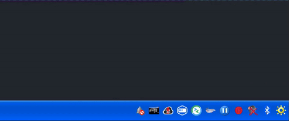

# vm_llm_notify

A KDE tray icon that flashes when a Claude Code session is waiting for you. Hooks, often running
inside a VM, POST their JSON to a tiny HTTP server. The tooltip shows which project is waiting and why.



## Run

```
cargo run -- --listen 192.168.122.1:9876
```

The listen address can also come from `VM_LLM_NOTIFY_LISTEN` or `settings.conf.json` in
`$XDG_CONFIG_HOME/vm_llm_notify/`. The default is `127.0.0.1:9876`. Use "Copy address for agent" in the tray menu to get the URL.

## Claude Code hooks

Add to `~/.claude/settings.json`, with `HOST` set to the listen address:

```json
{
  "hooks": {
    "Stop":             [{"hooks": [{"type": "http", "url": "http://HOST:9876", "timeout": 2}]}],
    "StopFailure":      [{"hooks": [{"type": "http", "url": "http://HOST:9876", "timeout": 2}]}],
    "Notification":     [{"hooks": [{"type": "http", "url": "http://HOST:9876", "timeout": 2}]}],
    "UserPromptSubmit": [{"hooks": [{"type": "http", "url": "http://HOST:9876", "timeout": 2}]}],
    "PostToolUse":      [{"hooks": [{"type": "http", "url": "http://HOST:9876", "timeout": 2}]}],
    "SessionEnd":       [{"hooks": [{"type": "http", "url": "http://HOST:9876", "timeout": 2}]}]
  }
}
```

Left-click the icon to clear all sessions. Use the menu to dismiss one.

The endpoint is unauthenticated. Only listen on a network you trust.
